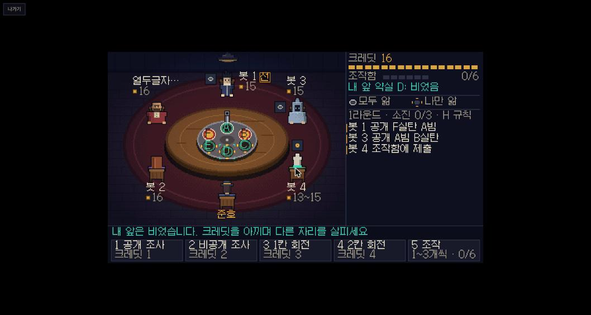
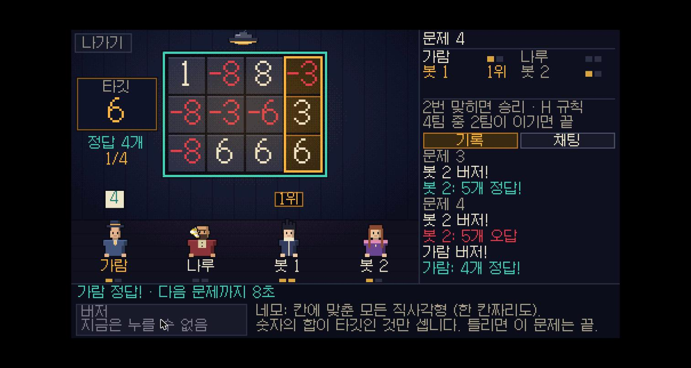
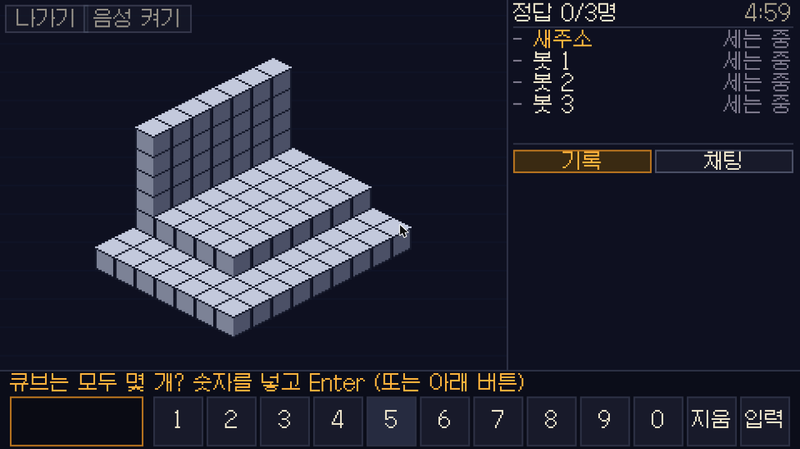

<h1 align="center">game-plan</h1>

<p align="center">
  《데블스 플랜: 데드 어게인》(시즌 3)의 게임을 규칙 그대로,<br />
  웹에서 여럿이 실시간으로 하는 픽셀 아트 게임 모음입니다.
</p>

<p align="center">
  <a href="https://game-plan.heojunfo.workers.dev"><b>지금 플레이하기</b></a>
  ·
  <a href="#게임">게임</a>
  ·
  <a href="#로컬에서-실행">로컬에서 실행</a>
  ·
  <a href="#구조">구조</a>
</p>

---

설치 없이 브라우저에서 엽니다. 로비에서 열린 방을 골라 들어가거나, 방을
만들거나, 친구가 준 방 코드를 넣으면 됩니다. 사람끼리 하는 게임만 제공합니다.

방송에서 가져온 것은 **게임의 규칙과 게임 이름**뿐입니다. 방송의 제목 로고,
출연자, 세트, 화면 구성은 쓰지 않습니다. 방송사·제작사와 관계없는 개인
프로젝트입니다.

## 게임

| 게임 | 인원 | 한 줄 설명 |
|---|---|---|
| **러시안 룰렛** | 4~6명 | 실탄이 든 약실을 캐내고 총구를 돌려, 마지막 격발에서 살아남으세요. |
| **네모 세기** | 1~16명 (3인 팀 가능) | 숫자를 더해 타깃이 되는 네모를 먼저 세어 버저를 누르세요. 두 번 맞히면 승리. |
| **잔디 깔기** | 2~16명 | 공원에 잔디 타일을 놓으면 번호만큼 승점. 큰 번호일수록 늦게 놓습니다. |
| **큐브 세기** | 1~16명 | 쌓인 큐브가 몇 개인지 먼저 세어 답하세요. 틀리면 20초 동안 잠깁니다. |

큐브 세기, 네모 세기, 잔디 깔기는 시즌 첫 메인 매치 "양자택일" 안의
미니게임으로, 하나씩 따로 만들고 있습니다. 미니게임에 딸린 양자택일의
선택은 그 게임 안에 들어 있습니다: 네모 세기에는 선택 2(팀·개인)와 판이
끝난 뒤의 선택 3(독식·헌신, 희생·질책, 도전·안전과 추가 대결), 잔디 깔기에는
선택 5~8(점수·정보, 공격·방어, 상생·견제, 가로수·맨홀).

큐브 세기와 네모 세기는 방에 혼자 있어도 시작할 수 있습니다 (세어서 맞히는
게임이라 상대 없이도 풀 수 있습니다. 봇은 들어오지 않습니다). 잔디 깔기와
러시안 룰렛은 사람이 모여야 시작합니다.

| 러시안 룰렛 | 네모 세기 |
|---|---|
|  |  |

| 잔디 깔기 | 큐브 세기 |
|---|---|
|  |  |

규칙은 방송에서 공개된 그대로이고, 공개된 규칙이 말하지 않는 부분은
방송 화면으로 확인하거나 임시로 채웠습니다. 무엇을 그대로 가져왔고 무엇을
채웠는지는 게임마다 적어 두었습니다.

- 러시안 룰렛: [`design/game-brief.md`](design/game-brief.md) (방송은 6인, 4·5인 탁자는 이 프로젝트가 줄인 것)
- 네모 세기: [`design/games/count-rectangles.md`](design/games/count-rectangles.md) (팀의 "대표"가 누구인지와 "추가 대결"의 방식은 공개된 규칙에 없어 채운 것)
- 잔디 깔기: [`design/games/lay-the-grass.md`](design/games/lay-the-grass.md)
- 큐브 세기: [`design/games/count-cubes.md`](design/games/count-cubes.md) (문제의 그림은 공개된 규칙에 없어 이 프로젝트가 채운 것)

## 방에서 되는 것

- **방 목록 로비**: 열린 방을 보고 들어가기, 방 만들기, 5자리 코드로 들어가기
- **공개 방과 비공개 방**: 공개 방은 목록에 보이고, 비공개 방은 코드로만 들어옵니다
- **한 방에 최대 16명** (러시안 룰렛 방은 6명: 방의 정원은 그 방의 게임이 받는 인원입니다), 게임이 진행 중일 때 들어온 사람은 그 판을 관전
- **채팅**: 대기실과 게임 중 모두. 서버는 전달만 하고 저장하지 않습니다
- **음성 채팅**: 비공개 방에서만 (브라우저끼리 직접 연결하는 WebRTC). 사람이 많은 방을 위해 말하지 않는 동안은 소리를 보내지 않도록 요청합니다
- **재접속**: 새로고침하거나 연결이 끊겨도 같은 자리로 돌아옵니다
- **자리 비움 처리**: 끊긴 사람의 차례는 30초 뒤 자동으로 넘어가고, 3분 동안 돌아오지 않으면 자리를 반납합니다. 게임하던 사람이 모두 끊긴 채 다른 사람이 방에서 기다리면 그 판은 3분 뒤 정리됩니다
- **차례 제한 시간**: 차례가 있는 게임(러시안 룰렛)은 방에서 없음, 60초, 120초 중에 고릅니다 (공개 방은 60초로 시작)

## 기술 구성

| 부분 | 쓰는 것 |
|---|---|
| 서버 | Cloudflare Workers + Durable Objects, [PartyServer](https://github.com/cloudflare/partykit/tree/main/packages/partyserver) |
| 클라이언트 | TypeScript, Canvas (480×270 픽셀 화면을 정수 배율로), [pixelfx](https://github.com/patch-gg/pixelfx) |
| 빌드 | Vite + Cloudflare Vite 플러그인 |
| 테스트 | Vitest (Workers 런타임에서 돌리는 통합 테스트 포함) |

방 하나가 Durable Object 하나(`GameRoom`)이고, 방 목록은 따로 하나
(`RoomDirectory`)가 맡습니다. 게임 규칙은 서버가 판정하고, 각 사람에게는 그
사람이 볼 수 있는 것만 보냅니다. Cloudflare 무료 요금제 안에서 돌아가도록
만들었습니다.

## 로컬에서 실행

Node.js 22 이상이 필요합니다.

```bash
git clone https://github.com/HEOJUNFO/Devils_Plan.git
cd Devils_Plan
npm install
npm run dev -- --port 5273
```

브라우저에서 `http://localhost:5273` 을 엽니다.

혼자서 확인하려면 탭마다 다른 사람으로 들어가거나 빈자리를 봇으로 채웁니다.

- **탭마다 다른 사람**: 주소에 `?profile=이름` 을 붙이면 탭마다 닉네임과 자리가 따로 저장됩니다
- **봇으로 채우기**: 저장소 루트에 `.dev.vars` 파일을 만들어 `ALLOW_BOTS=true` 를 적고, 주소에 `?bots=1` 을 붙입니다
- **마이크 없이 음성 확인**: `?fakemic=1` (localhost에서만 동작, 마이크 대신 신호음)

봇은 개발과 테스트용입니다. 규칙에 맞는 수를 두어 한 판을 끝낼 수 있는
정도이고, 배포된 서버에서는 꺼져 있습니다.

### 명령어

| 명령어 | 하는 일 |
|---|---|
| `npm run dev` | 클라이언트와 서버(Workers 런타임)를 함께 띄웁니다 |
| `npm run typecheck` | 서버, 클라이언트, 테스트의 타입 검사 |
| `npm test` | 전체 테스트. 일부만 돌리려면 `npx vitest run tests/unit/lobby` 처럼 경로를 줍니다 |
| `npm run smoke` | 떠 있는 서버에 실제 소켓으로 접속해 네 게임을 진행해 봅니다 (기본 주소 `http://localhost:5273`) |
| `npm run build` | 배포용 빌드 |
| `npm run deploy` | 빌드한 뒤 `wrangler deploy` (평소에는 쓰지 않습니다. 아래 배포 참고) |

## 구조

```
src/
  server/                 # Worker: 방(GameRoom), 방 목록(RoomDirectory), 타이머
  shared/                 # 서버와 클라이언트가 같이 쓰는 순수 로직
    games.json            #   게임 목록: 이름, 설명, 인원
    hosts.ts              #   게임 id → 그 게임을 진행하는 호스트
    game/                 #   러시안 룰렛 규칙, 기본 봇
    games/<게임 id>/       #   네모 세기, 잔디 깔기, 큐브 세기의 규칙과 설정
    protocol.ts           #   소켓 메시지
    *-config.json         #   방, 채팅, 음성, 방 목록의 설정값
  client/                 # 브라우저: 로비, 대기실, 채팅, 음성
    game/                 #   러시안 룰렛 화면, 공통 그리기
    games/<게임 id>/       #   게임별 화면
tests/
  unit/                   # 규칙과 순수 로직
  integration/            # 방을 실제 Workers 런타임에 띄워서 확인
tools/smoke.mjs           # npm run smoke
design/                   # 게임별 설계 기록 (규칙의 출처, 채운 부분)
assets/                   # 글꼴과 출처 기록 (provenance.yaml)
vendor/pixelfx/           # 픽셀 이펙트 라이브러리 사본
prototypes/empty-chamber/ # 러시안 룰렛의 첫 빌드 (더 손대지 않음)
production/qa/evidence/   # 화면을 바꿀 때마다 남긴 스크린샷
.claude/                  # Claude Code용 에이전트, 스킬, 훅, 규칙
```

숫자로 된 값(인원, 시간, 크레딧, 타일 모양)은 코드가 아니라 JSON 설정
파일에 있습니다.

### 게임을 하나 더 넣으려면

1. `src/shared/games.json` 에 id, 이름, 설명, 인원을 추가
2. `src/shared/games/<id>/` 에 규칙(`rules.ts`)과 호스트(`host.ts`)를 만들고 `src/shared/hosts.ts` 에 등록
3. `src/client/games/<id>/screen.ts` 에 화면을 만들고 `src/client/games/index.ts` 에 등록
4. `tests/unit/<id>/`, `tests/integration/` 에 테스트, `design/games/<id>.md` 에 규칙의 출처

방(`src/server/room.ts`)은 게임 안을 들여다보지 않고 호스트에 맡기므로, 방
코드는 고치지 않아도 됩니다.

## 배포

`main` 에 푸시하면 Cloudflare Workers Builds가 타입 검사, 테스트, 빌드를 거쳐
배포합니다. GitHub Actions(`.github/workflows/deploy.yml`)는 푸시와 PR마다
같은 검사만 하고 배포는 하지 않습니다. 그래서 GitHub에는 Cloudflare 인증
정보가 없습니다.

## 프로젝트 규칙

전체는 [`CLAUDE.md`](CLAUDE.md)의 Project Rules에 있습니다.

- **멀티플레이가 제품이고 봇은 테스트 도구입니다.** 봇은 게임마다 기본형 하나만 둡니다
- **게임 이름은 방송에서 부르는 이름을 씁니다.** 규칙도 문서 그대로 씁니다
- **로비는 방 목록입니다.** 닉네임과 코드만 있는 화면은 로비가 아닙니다
- **고친 부분만 검사합니다.** 전체 테스트는 푸시할 때 CI가 돌립니다

## 만든 방법

[Claude Code](https://code.claude.com/docs)와
[Claude Code Game Studios](https://github.com/Donchitos/Claude-Code-Game-Studios)
템플릿으로 개발합니다. `.claude/` 폴더, `project.yaml`, `studio-tests/`,
`docs/` 의 작업 흐름 문서는 그 템플릿의 것입니다. 템플릿 사용법은 템플릿
저장소의 README와 [`docs/WORKFLOW-GUIDE.md`](docs/WORKFLOW-GUIDE.md)를 보세요.

## 출처와 라이선스

- 코드: MIT. [LICENSE](LICENSE) 참고 (템플릿의 저작권 표시 포함)
- 글꼴: [Galmuri11](https://github.com/quiple/galmuri), SIL Open Font License 1.1 ([`assets/fonts/Galmuri11-LICENSE.txt`](assets/fonts/Galmuri11-LICENSE.txt))
- 픽셀 이펙트: [pixelfx](https://github.com/patch-gg/pixelfx), MIT ([`vendor/pixelfx/LICENSE`](vendor/pixelfx/LICENSE))
